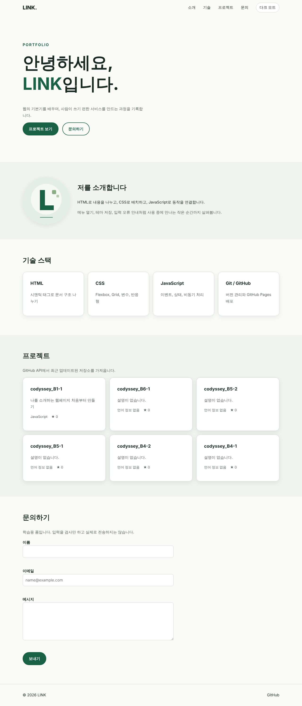
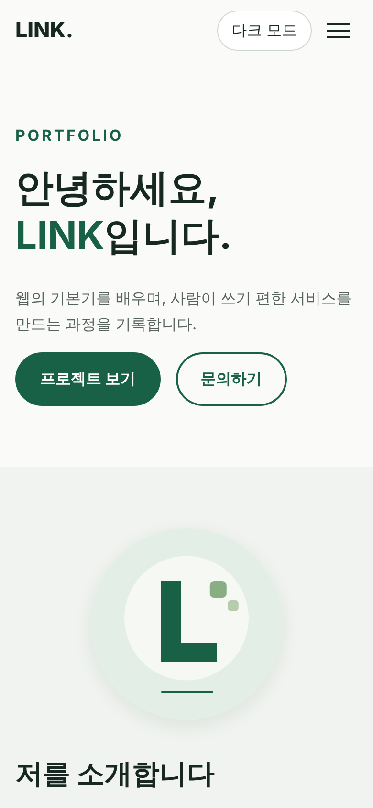
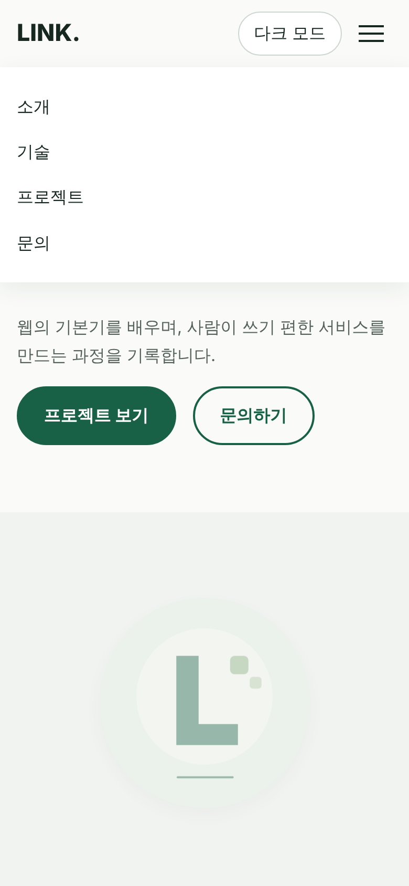
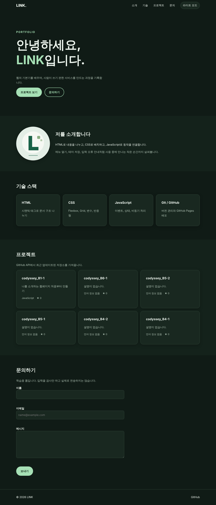
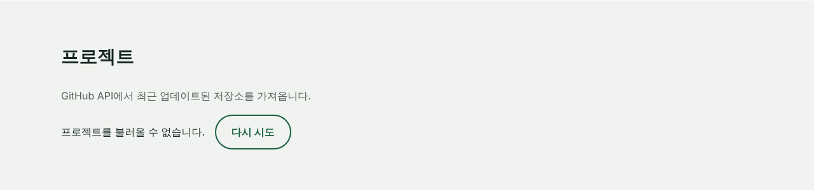

# B1-1 · 나를 소개하는 웹페이지 처음부터 만들기

| 분야 | 구분 | 학습시간 | 필수/선택 |
|---|---|---|---|
| AI/SW 기초 | 웹 기초와 프론트엔드 | 80시간 | 필수 |

**순수 HTML / CSS / JavaScript (라이브러리 없음) / 범위: 필수 요구사항만 (보너스 제외)**

- **배포 URL**: https://codewhite7777.github.io/codyssey_B1-1/
- **저장소**: https://github.com/codewhite7777/codyssey_B1-1

이 README는 세 부분으로 되어 있습니다.

| 순서 | 섹션 | 내용 |
|---|---|---|
| 1 | [구조 설계](#구조-설계) | 파일을 어떻게 나눴고, 화면과 JS 코드를 어떤 구조로 짰는지 |
| 2 | [실행과 확인 흐름](#실행과-확인-흐름) | 레포 받기부터 기능 하나씩 확인하는 7단계 |
| 3 | [과제 요구사항 대응](#과제-요구사항-대응) | 과제 문서 1~8의 요구마다 어디에 구현했는지 |

> **평가하시는 분은 [구조 설계](#구조-설계)로 전체 모양을 먼저 보고, [실행과 확인 흐름](#실행과-확인-흐름)을 1단계부터 따라 하면 됩니다.** 개념 설명은 [docs/concepts.md](docs/concepts.md)에 그림과 함께 있습니다.

| 함께 보는 문서 | 내용 |
|---|---|
| [docs/concepts.md](docs/concepts.md) | 평가 질문 15개에 필요한 개념 10개를 그림, 이 레포 코드, 스스로 확인 문제로 정리 |
| [docs/evaluation.md](docs/evaluation.md) | 평가 체크리스트 항목 1~4마다 보여줄 코드 위치와 말하기 예시 |

## 진행 상황

| 단계 | 할 일 | 파일 | 상태 |
|---|---|---|---|
| A. HTML | 시맨틱 태그로 6개 섹션 구조 | `index.html` | ✅ |
| B. CSS | 변수, 다크 모드, Flexbox/Grid, 모바일 퍼스트 반응형 | `css/style.css` | ✅ |
| C. JS 인터랙션 | 다크 모드, 햄버거 메뉴, 부드러운 스크롤, 맨 위로, 스크롤 애니메이션 | `js/app.js` 3~7 | ✅ |
| D. JS API | GitHub API, 로딩/성공/에러/빈 상태 | `js/app.js` 8 | ✅ |
| E. JS 폼 | 필수값, 이메일 형식 검사 | `js/app.js` 9 | ✅ |
| F. 배포 | GitHub Pages, 스크린샷 | [배포 URL](https://codewhite7777.github.io/codyssey_B1-1/), `images/screenshots/` | ✅ |
| G. 개념 정리 | 평가 질문별 필요한 개념, 개념마다 그림, 코드에 `[개념 N]` 주석 | `docs/concepts.md`, `docs/images/` | ✅ |

---

## 구조 설계

### 파일 구조: 역할마다 파일을 나눈다

```text
codyssey_B1-1/
├── index.html           내용과 구조 (무엇이 있나)
├── css/
│   └── style.css        모양 (어떻게 보이나)
├── js/
│   └── app.js           동작 (클릭하면 무엇이 바뀌나)
├── images/
│   ├── profile.svg      About 프로필 이미지
│   └── screenshots/     제출용 스크린샷
├── docs/
│   ├── concepts.md      개념 정리 (그림 + 코드 + 확인 문제)
│   ├── evaluation.md    평가 준비
│   └── images/          개념 그림 SVG (00 개념 지도, 01~13 개념별)
└── .vscode/             Live Server 추천 확장과 포트 설정
```

| 파일 | 역할 | 나눠서 좋은 점 |
|---|---|---|
| `index.html` | 내용과 구조 | 글을 고칠 때 HTML만 보면 됨 |
| `css/style.css` | 색, 배치, 반응형 | 디자인을 바꿔도 HTML, JS는 그대로 |
| `js/app.js` | 이벤트, 상태, 화면 갱신 | 동작 코드가 한곳에 모여 흐름을 따라가기 쉬움 |


HTML에서는 `<link rel="stylesheet" href="css/style.css">`와 `<script src="js/app.js" defer>`로 두 파일을 연결합니다. `defer`는 **HTML을 다 읽은 뒤에** JS를 실행하라는 뜻이라, JS가 `querySelector`로 요소를 찾을 때 요소가 이미 있습니다.

### 화면 구조: 시맨틱 태그로 영역을 나눈다


| 태그 | 고른 기준 |
|---|---|
| `header`, `nav` | 모든 페이지에 반복되는 머리말과 이동 메뉴 |
| `main` | 이 페이지의 핵심 내용 (한 페이지에 하나) |
| `section` | 제목(h1·h2)이 붙는 주제 묶음. 메뉴가 `id`로 찾아감 |
| `article` | 따로 떼어도 뜻이 통하는 한 덩어리 → 프로젝트 카드 하나 |
| `footer` | 페이지 맨 아래 부가 정보 |

### JS 구조: 이벤트 → 상태 변경 → 화면 업데이트

`js/app.js`는 번호 붙은 10개 구역으로 되어 있고, 모든 기능이 같은 흐름을 따릅니다.


| 구역 | 내용 |
|---|---|
| [0. 설정값](js/app.js#L9-L17) | 60px, 300px, 0.2 같은 기준값 (아래 [동작 기준값](#동작-기준값)과 같은 값) |
| [1. STATE](js/app.js#L19-L31) | 화면을 결정하는 값을 한 객체에 모음 |
| [2. DOM 선택](js/app.js#L33-L48) | `querySelector`로 요소를 한 번만 찾아 둠 |
| [3~9. 기능](js/app.js#L50-L252) | 다크 모드, 메뉴, 부드러운 스크롤, 스크롤, 애니메이션, API, 폼 |
| [10. 시작](js/app.js#L254-L260) | 저장된 테마 복원, 프로젝트 요청 |

**규칙**: 이벤트 핸들러는 STATE만 바꾸고, 화면은 render 함수만 바꿉니다. 그래서 "화면이 왜 이렇게 보이지?"의 답은 항상 STATE에 있습니다.

### 동작 기준값

| 항목 | 값 | 코드 |
|---|---|---|
| 네비게이션 배경 변경 | 스크롤 60px 이상 | `NAV_SCROLL_Y` |
| 맨 위로 버튼 표시 | 스크롤 300px 이상 | `TOP_BUTTON_Y` |
| 스크롤 애니메이션 threshold | 0.2 (요소가 20% 보이면) | `REVEAL_THRESHOLD` |
| 반응형 브레이크포인트 | 768px(태블릿), 1024px(데스크톱) | `css/style.css` 5번 |
| 프로젝트 카드 수 | 최근 업데이트 순 6개 (fork 제외) | `PROJECT_COUNT` |
| 테마 저장 키 | `localStorage`의 `theme` | `THEME_KEY` |

---

## 실행과 확인 흐름

**레포 받기 → Live Server로 열기 → 기능을 하나씩 확인** 순서입니다. 배포 URL에서 바로 확인해도 같습니다.

### 1단계. 레포 받고 Live Server로 열기

```bash
git clone https://github.com/codewhite7777/codyssey_B1-1.git
code codyssey_B1-1
```

VS Code가 추천하는 **Live Server** 확장을 설치하고, `index.html`에서 오른쪽 클릭 → **Open with Live Server**.

**결과**: 브라우저에 `http://127.0.0.1:5500/index.html`이 열립니다. 파일을 저장하면 자동으로 새로고침됩니다.

### 2단계. 반응형 레이아웃 확인

크롬 개발자 도구(F12) → 기기 툴바(Ctrl+Shift+M)에서 폭을 바꿔 봅니다.

| 폭 (예) | 메뉴 | 기술 카드 | 프로젝트 카드 |
|---|---|---|---|
| 390px (휴대폰) | 숨김, 햄버거 버튼 | 1열 | 1열 |
| 768px (태블릿) | 가로 메뉴 | 2열 | 2열 |
| 1280px (데스크톱) | 가로 메뉴 | 4열 | 3열 |

메뉴와 기술 카드는 미디어 쿼리(768px, 1024px)로 바뀝니다. 프로젝트 카드는 미디어 쿼리 없이 `repeat(auto-fit, minmax(280px, 1fr))`이 "280px 카드가 몇 개 들어가나"로 정해서, 열이 바뀌는 폭이 608px(2열), 904px(3열)로 다릅니다.

### 3단계. 다크 모드 확인

1. 오른쪽 위 **다크 모드** 버튼 클릭 → 화면 전체 색이 바뀌고 버튼 글자가 **라이트 모드**로 바뀜
2. 새로고침(F5) → **다크 모드가 유지됨**
3. 개발자 도구 → Application → Local Storage에서 `theme: dark` 확인

### 4단계. 메뉴와 스크롤 확인

| 해볼 것 | 결과 |
|---|---|
| (모바일 폭) 햄버거 버튼 클릭 | 메뉴가 열림. 다시 클릭하면 닫힘 |
| 메뉴의 "프로젝트" 클릭 | 해당 섹션으로 부드럽게 이동 (모바일이면 메뉴도 닫힘) |
| 60px 이상 스크롤 | 네비게이션 배경이 바뀌고 그림자가 생김 |
| 300px 이상 스크롤 | 오른쪽 아래 ↑ 버튼이 나타남. 클릭하면 맨 위로 이동 |
| 아래로 스크롤 | 프로필, 기술 카드가 아래에서 올라오며 나타남 |

### 5단계. GitHub API 네 가지 상태 확인

| 상태 | 확인 방법 | 화면 |
|---|---|---|
| 로딩 | 개발자 도구 Network에서 **Slow 3G**로 바꾸고 새로고침 | 스피너 + "로딩 중..." |
| 성공 | 그냥 새로고침 | 저장소 카드 6개 |
| 에러 | Network 탭에서 `repos` 요청을 오른쪽 클릭 → **Block request domain** → 새로고침 | "프로젝트를 불러올 수 없습니다." + **다시 시도** 버튼 → 아래 **Network request blocking** 탭에서 체크를 풀고 다시 시도를 누르면 카드가 나옴 |
| 빈 상태 | 콘솔(Console)에서 `STATE.projectStatus = "empty"; renderProjects();` | "표시할 프로젝트가 없습니다." |

빈 상태는 실제 계정에 저장소가 있어서 콘솔로 **상태만 바꿔 render를 다시 부릅니다**. 상태만 바꾸면 화면이 따라 바뀐다는 것도 같이 보입니다.

> GitHub API는 로그인 없이 **시간당 60번**까지만 됩니다. 넘으면 403 응답이 오고, 이것도 에러 상태로 표시됩니다.

### 6단계. 폼 검증 확인

| 해볼 것 | 결과 |
|---|---|
| 아무것도 안 쓰고 **보내기** | 세 칸 아래에 "필수 입력 항목입니다." + 빨간 테두리 |
| 이메일에 `abc` 입력 | 입력하는 즉시 "이메일 형식이 아닙니다." |
| 이메일을 `a@b.co`로 고침 | 오류 문구가 바로 사라짐 |
| 세 칸 다 채우고 **보내기** | 페이지 새로고침 없이 "메시지가 확인되었습니다." 표시, 입력칸 비워짐 |

### 7단계. 배포 사이트 확인

https://codewhite7777.github.io/codyssey_B1-1/ 에서 2~6단계가 같게 동작합니다.

---

## 과제 요구사항 대응

### 1. 미션 소개

라이브러리 없이 HTML, CSS, JS만으로 반응형 포트폴리오를 만들고, 모든 동작을 **이벤트 → 상태 변경 → 화면 업데이트** 흐름으로 짰습니다 ([JS 구조](#js-구조-이벤트--상태-변경--화면-업데이트)).

### 2. 최종 결과물

| 과제 요구 | 어디서 | 상태 |
|---|---|---|
| 반응형, 6개 섹션 | `index.html`, [2단계](#2단계-반응형-레이아웃-확인) | ✅ |
| 다크 모드, 햄버거, 부드러운 스크롤, 스크롤 애니메이션, 폼 검증 | `js/app.js` 3~9, [3~6단계](#3단계-다크-모드-확인) | ✅ |
| GitHub API 연동, 로딩/에러/빈 상태 | `js/app.js` 8, [5단계](#5단계-github-api-네-가지-상태-확인) | ✅ |
| 다크 모드 로컬스토리지 유지 | `js/app.js` 3, 10 | ✅ |
| GitHub Pages 배포 | [배포 URL](https://codewhite7777.github.io/codyssey_B1-1/) | ✅ |

### 3. 과제 목표

| 목표 | 한 줄 답 | 자세히 |
|---|---|---|
| 시맨틱 태그와 구조 설계 기준 | 태그 이름만 보고도 영역의 역할을 알 수 있게 | [개념 2](docs/concepts.md#2-시맨틱-태그-태그-이름이-곧-역할) |
| Flexbox와 Grid 차이 | Flex는 한 줄(가로 또는 세로) 정렬, Grid는 행과 열 2차원 배치 | [개념 4](docs/concepts.md#4-flexbox와-grid-한-줄이냐-바둑판이냐) |
| querySelector → addEventListener | 요소를 찾고, 그 요소에 "이 일이 생기면 이 함수 실행"을 붙임 | [개념 6](docs/concepts.md#6-dom-선택과-이벤트-찾아서-붙인다) |
| 화살표 함수, 구조분해, map/filter | 짧게 쓰기, 객체에서 필요한 값만 꺼내기, 배열을 새 배열로 바꾸기 | [개념 8](docs/concepts.md#8-es6-문법과-배열-메서드-github-데이터--카드) |
| fetch, async/await, 상태 UI | 응답을 기다린 뒤 성공/실패에 따라 상태를 바꾸고 render | [개념 9](docs/concepts.md#9-비동기-fetch-asyncawait-trycatch) |
| 이벤트 → 상태 → DOM | 핸들러는 STATE만, render는 화면만 | [개념 7](docs/concepts.md#7-이벤트--상태-변경--화면-업데이트) |

### 4. 기능 요구 사항

#### 4-1. 프로젝트 기본 구성

| 요구 | 어디서 |
|---|---|
| `index.html`, `css/`, `js/`, `images/` 분리 | [파일 구조](#파일-구조-역할마다-파일을-나눈다) |
| 외부 CSS, JS 연결 | [index.html 11~13줄](index.html#L11-L13) |
| VS Code + Live Server | `.vscode/extensions.json`(추천 확장), `.vscode/settings.json`(포트 5500) |

#### 4-2. HTML 구조

| 요구 | 어디서 |
|---|---|
| header, nav, main, section, article, footer | [index.html](index.html), article은 [app.js 카드 생성](js/app.js#L141-L159) |
| Hero, About, Skills, Projects, Contact, Footer | `id="hero"`, `about`, `skills`, `projects`, `contact`, `<footer>` |
| 메뉴 앵커 링크 | `<a href="#about">` 등 → 같은 `id`의 section |
| 이미지 alt | [프로필 이미지](index.html#L61) |
| label for ↔ input id | [폼](index.html#L116-L136): `for="name"` ↔ `id="name"` 등 3쌍 |

#### 4-3. CSS

| 요구 | 어디서 |
|---|---|
| 외부 스타일시트 `css/style.css` | ✅ |
| `:root` 변수 (색상, 폰트, 간격) | [style.css 1번](css/style.css#L6-L34) |
| `[data-theme="dark"]` 변수 | [style.css 1번](css/style.css#L36-L52) |
| 네비게이션 Flexbox | [`.nav`](css/style.css#L114-L121) |
| 프로젝트 카드 Grid `auto-fit` + `minmax` | [`.project-grid`](css/style.css#L194-L203) |
| 모바일 퍼스트, 768px / 1024px | 기본 스타일이 모바일, [`min-width` 미디어 쿼리](css/style.css#L267-L294) |
| 모바일에서 메뉴 숨김 + 햄버거 | `.nav-menu { display: none }` → 768px 이상에서 보이고 햄버거 숨김 |
| hover + transition, box-shadow | `.button`, `.skill-card`, `.project-card` |

#### 4-4. JavaScript 기초

| 요구 | 어디서 |
|---|---|
| `defer`로 연결 | [index.html 13줄](index.html#L13) |
| `const`, `let`만 (var 없음) | `js/app.js` 전체 |
| onclick 없이 addEventListener | `index.html`에 `onclick` 없음 |
| querySelector / querySelectorAll | app.js 2번, 5번, 7번 |
| textContent / innerHTML | `projectMessage.textContent`, `projectGrid.innerHTML` (8번) |
| classList add / remove / toggle | add: 애니메이션(7번), remove·add: 폼 오류(9번), toggle: 메뉴(4번), 스크롤(6번) |
| click, submit, scroll, input 이벤트 | 3·4번 click, 9번 submit·input, 6번 scroll |
| preventDefault | 5번 링크 클릭, 9번 폼 제출 |

#### 4-5. 인터랙션

| 요구 | 코드 | 확인 |
|---|---|---|
| 햄버거 메뉴 `classList.toggle('active')` | [app.js 4번](js/app.js#L67-L80) | [4단계](#4단계-메뉴와-스크롤-확인) |
| 부드러운 스크롤 | [app.js 5번](js/app.js#L82-L95) | 4단계 |
| 맨 위로 버튼 (300px) | [app.js 6번](js/app.js#L97-L108) | 4단계 |
| 네비게이션 배경 (60px) | app.js 6번 | 4단계 |
| 다크 모드 + 로컬스토리지 | [app.js 3번](js/app.js#L50-L65), [10번](js/app.js#L254-L260) | [3단계](#3단계-다크-모드-확인) |
| 스크롤 애니메이션 (threshold 0.2) | [app.js 7번](js/app.js#L110-L128) | 4단계 |
| 폼: 필수값, 이메일 형식, 필드 근처 오류, preventDefault + 성공 메시지 | [app.js 9번](js/app.js#L201-L252) | [6단계](#6단계-폼-검증-확인) |

#### 4-6. ES6+ 문법과 배열 메서드

| 요구 | 어디서 |
|---|---|
| 화살표 함수 | 모든 함수 (`const renderTheme = () => {...}`) |
| 템플릿 리터럴로 HTML 생성 | [`createCard`](js/app.js#L141-L159) |
| 구조분해 할당 | `createCard`의 `const { name, description, ... } = repo`, `renderProjects`의 `const { projectStatus, projects } = STATE`, `renderForm`의 `([name, message])` |
| map | 저장소 배열 → 카드 HTML 배열 |
| filter | fork 저장소 빼기 |
| forEach | 링크, `.reveal` 요소, 폼 입력칸 순회 |

#### 4-7. 비동기 처리와 API

| 요구 | 어디서 |
|---|---|
| fetch + async/await | [`loadProjects`](js/app.js#L172-L199) |
| 엔드포인트 | `https://api.github.com/users/codewhite7777/repos?sort=updated` |
| 로딩 / 성공 / 에러 / 빈 상태 | `STATE.projectStatus` 4가지 → [`renderProjects`](js/app.js#L161-L170) |
| try/catch | 네트워크 실패, `response.ok`가 아닌 응답(403 포함) 모두 catch → 에러 상태 |

#### 4-8. 상태 관리 패턴 (3가지 이상)

| 흐름 | 이벤트 | 상태 | 렌더링 |
|---|---|---|---|
| 1 | 다크 모드 클릭 | `STATE.theme` | `renderTheme` → 전체 색 |
| 2 | 페이지 시작 / 다시 시도 클릭 | `STATE.projectStatus`, `STATE.projects` | `renderProjects` → Projects 섹션 |
| 3 | 폼 입력 / 제출 | `STATE.formErrors`, `STATE.formSent` | `renderForm` → 오류 문구, 성공 메시지 |
| 4 | 햄버거 클릭 | `STATE.menuOpen` | `renderMenu` → 메뉴 열림/닫힘 |

#### 4-9. 배포

GitHub Pages, **main 브랜치 / 루트(`/`)** 에서 배포합니다. 빌드 과정이 없어 `index.html`이 그대로 사이트가 됩니다.

### 5. 보너스 과제

이번 범위에서는 하지 않습니다. 필수 요구사항에 집중합니다.

### 6. 개발 환경

| 항목 | 사용 |
|---|---|
| 언어 | HTML, CSS, JavaScript (라이브러리, 프레임워크 없음) |
| 편집기 | VS Code + Live Server |
| 브라우저 | Chrome 최신 |
| 배포 | GitHub Pages |

### 7. 제약 사항

| 제약 | 지킨 방법 |
|---|---|
| 외부 라이브러리 금지 | CSS, JS 모두 직접 작성. 외부 파일을 하나도 불러오지 않음 |
| `var` 대신 `const`, `let` | `var` 없음 |
| onclick 대신 addEventListener | `onclick` 없음 |
| 인라인 스타일 금지 | `style="..."` 없음. 보이기/숨기기는 class와 `hidden` 속성 |
| 403(레이트 리밋) 처리 | `response.ok` 검사 → 에러 상태 + 다시 시도 버튼 |

### 8. 스크린샷

| 데스크톱 | 모바일 | 모바일 메뉴 |
|---|---|---|
|  |  |  |

| 다크 모드 | 에러 상태 |
|---|---|
|  |  |
