# 개념 정리

피어평가는 **동작하는가**(항목 1)와 **설명할 수 있는가**(항목 2~4)를 봅니다.
평가 질문 15개에 답하려면 아래 **개념 10개**가 필요합니다. 각 개념은 **핵심 한 줄 → 그림 → 설명 → 이 레포 코드 → 스스로 확인** 순서이고, 그림은 모두 이 레포 코드를 기준으로 그렸습니다.

[← README](../README.md) · [평가 준비](evaluation.md)

## 평가에 필요한 개념

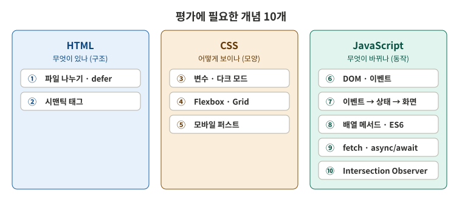

### 평가 질문별로 필요한 개념

| 평가 항목 | 평가 질문 (요약) | 필요한 개념 | 한 줄 답 |
|---|---|---|---|
| 1. 동작 | 창을 줄이면 모바일 레이아웃으로 바뀌나? | [⑤](#5-모바일-퍼스트-반응형-기본은-휴대폰-넓어지면-더하기) [④](#4-flexbox와-grid-한-줄이냐-바둑판이냐) | 기본 = 휴대폰, `min-width`로 넓은 화면만 더함. 카드는 `auto-fit` |
|  | 다크 모드 전환, 새로고침 후 유지? | [③](#3-css-변수와-다크-모드-그리고-localstorage) | CSS 변수 값만 교체, `localStorage`에 저장했다가 시작할 때 꺼냄 |
|  | 햄버거, 스크롤 애니메이션, 맨 위로 버튼? | [⑥](#6-dom-선택과-이벤트-찾아서-붙인다) [⑩](#10-intersection-observer-보이면-나타나기) | click, scroll 이벤트로 클래스를 붙였다 뗌. 애니메이션은 20% 보이면 |
|  | GitHub 데이터, 로딩/에러/빈 상태 구분? | [⑨](#9-비동기-fetch-asyncawait-trycatch) [⑦](#7-이벤트--상태-변경--화면-업데이트) | 요청 결과로 상태 4개 중 하나 → `renderProjects` |
|  | 필수값, 이메일 오류에 즉시 피드백? | [⑥](#6-dom-선택과-이벤트-찾아서-붙인다) [⑦](#7-이벤트--상태-변경--화면-업데이트) | `input` 이벤트마다 그 칸 검사 → `renderForm` |
| 2. 구조 | HTML, CSS, JS를 나눈 이유와 역할 | [①](#1-html-css-js를-왜-나누나-defer는-뭔가) | 무엇이 있나 / 어떻게 보이나 / 무엇이 바뀌나 |
|  | 시맨틱 태그를 고른 기준 | [②](#2-시맨틱-태그-태그-이름이-곧-역할) | 태그 이름이 곧 역할 |
|  | CSS 변수(:root)의 이점 | [③](#3-css-변수와-다크-모드-그리고-localstorage) | 한 곳에서 관리, 다크 모드는 값만 바꿈 |
|  | onclick 대신 addEventListener | [⑥](#6-dom-선택과-이벤트-찾아서-붙인다) | 함수 하나 vs 여러 개, HTML과 JS 분리 |
| 3. 흐름 | 이벤트 → 상태 → 화면을 코드로 따라가기 | [⑦](#7-이벤트--상태-변경--화면-업데이트) | 핸들러는 STATE만, 화면은 render만 |
|  | async/await, try/catch로 성공/실패 분기 | [⑨](#9-비동기-fetch-asyncawait-trycatch) | `await`로 기다림, `ok`가 아니면 throw → catch |
|  | map, filter로 GitHub 데이터 → 카드 | [⑧](#8-es6-문법과-배열-메서드-github-데이터--카드) | filter → slice → map → join → innerHTML |
|  | Flexbox와 Grid를 어디에, 왜 | [④](#4-flexbox와-grid-한-줄이냐-바둑판이냐) | 한 줄 정렬 vs 행 × 열 배치 |
| 4. 이유 | STATE 객체를 따로 둔 이유 | [⑦](#7-이벤트--상태-변경--화면-업데이트) | 화면을 결정하는 값이 한 곳에 모임 |
|  | 모바일 퍼스트로 쓴 이유 | [⑤](#5-모바일-퍼스트-반응형-기본은-휴대폰-넓어지면-더하기) | 단순한 화면에서 시작해 더하기 |

> 각 질문을 시연하고 말하는 방법은 [평가 준비](evaluation.md)에 있습니다. 이 문서는 그 답의 **바탕이 되는 개념**을 설명합니다.

코드의 주석에도 `[개념 N]`으로 이 문서의 번호를 적어 두었습니다.

---

## 1. HTML, CSS, JS를 왜 나누나, defer는 뭔가

> **HTML은 무엇이 있나, CSS는 어떻게 보이나, JS는 무엇이 바뀌나.** 역할마다 파일을 나누면 고칠 곳이 분명해진다.

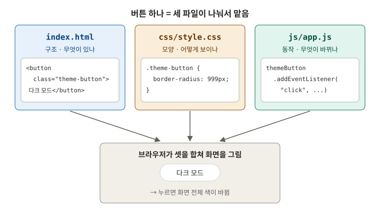

| 파일 | 역할 | 이것만 고치면 되는 경우 |
|---|---|---|
| `index.html` | 내용과 구조 | 소개 글을 바꿀 때 |
| `css/style.css` | 색, 크기, 배치 | 버튼 색, 카드 열 수를 바꿀 때 |
| `js/app.js` | 이벤트, 상태, 화면 갱신 | 클릭했을 때 동작을 바꿀 때 |

한 파일에 섞으면(HTML에 `style="..."`, `onclick="..."`) 버튼 색 하나 바꾸려고 HTML을 뒤져야 하고, 같은 스타일을 여러 곳에 반복하게 됩니다. 과제가 **인라인 스타일과 onclick을 금지**하는 이유도 같습니다.

### defer: HTML을 다 읽은 뒤에 JS 실행

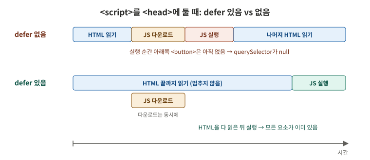

- 브라우저는 HTML을 **위에서 아래로** 읽습니다. `<head>`에서 그냥 `<script>`를 만나면 HTML 읽기를 **멈추고** JS를 받아 실행합니다.
- 그 순간에는 아래쪽 `<button>`이 아직 없어서 `document.querySelector(".theme-button")`가 `null`이 되고, `null.addEventListener(...)`에서 에러가 납니다.
- `defer`를 붙이면 JS는 **동시에 내려받고, 실행은 HTML을 다 읽은 뒤**에 합니다. 그래서 app.js 맨 위에서 바로 요소를 찾을 수 있습니다.

**이 레포 코드**: [index.html 10~13줄](../index.html#L10-L13)

```html
<link rel="stylesheet" href="css/style.css">
<script src="js/app.js" defer></script>
```

<details>
<summary><b>스스로 확인</b>: index.html에서 <code>defer</code>를 지우면 어떻게 될까?</summary>

`<script src="js/app.js">`가 `<head>`에 있으므로 `<body>`를 읽기 전에 실행됩니다. app.js 2번의 `document.querySelector(".theme-button")`가 `null`을 돌려주고, 3번의 `themeButton.addEventListener(...)`에서 `TypeError: Cannot read properties of null`이 납니다. 다크 모드, 메뉴, API 등 그 아래 코드가 모두 실행되지 않습니다.
</details>

**더 보기**: [defer, async 스크립트 (javascript.info)](https://ko.javascript.info/script-async-defer) · [`<script>` 요소 (MDN)](https://developer.mozilla.org/ko/docs/Web/HTML/Reference/Elements/script)

---

## 2. 시맨틱 태그: 태그 이름이 곧 역할

> `div`는 "상자"라는 뜻뿐이다. `header`, `nav`, `main`, `section`, `article`, `footer`는 **그 영역이 무엇인지**까지 말해 준다.

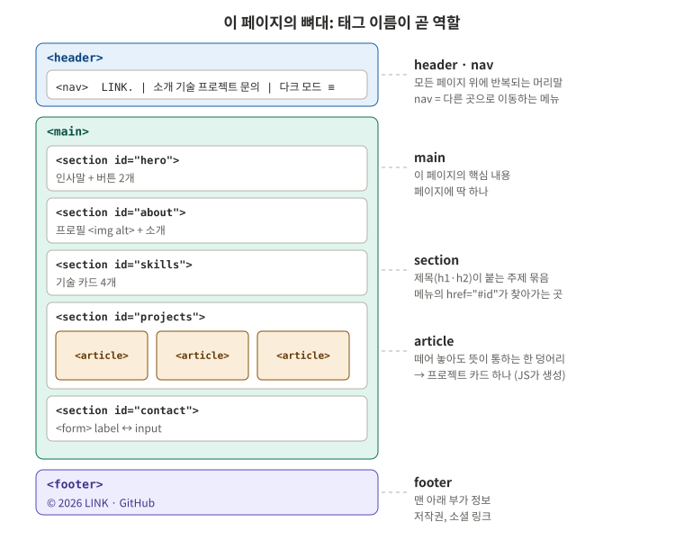

| 태그 | 고른 기준 | 이 페이지에서 |
|---|---|---|
| `header` | 페이지(사이트) 머리말 | 로고, 메뉴, 버튼 |
| `nav` | 다른 곳으로 **이동**하는 링크 묶음 | 소개, 기술, 프로젝트, 문의 |
| `main` | 이 페이지의 **핵심 내용**. 페이지에 하나 | 섹션 5개 |
| `section` | **제목(h1·h2)이 붙는** 주제 묶음 | hero, about, skills, projects, contact |
| `article` | 떼어 놓아도 **혼자 뜻이 통하는** 한 덩어리 | 프로젝트 카드 하나 |
| `footer` | 맨 아래 부가 정보 | 저작권, GitHub 링크 |

**왜 쓰나**
- **사람**: 코드만 봐도 구조가 보입니다. `<div class="header">`보다 `<header>`가 바로 읽힙니다.
- **화면 낭독기**: 시각장애인이 쓰는 화면 낭독기는 `nav`, `main`을 "탐색 영역", "본문"으로 알려 주고 바로 건너뛸 수 있게 합니다.
- **검색 엔진**: 어디가 본문인지 알기 쉽습니다.

**함께 지킨 것**: 모든 ``에 `alt`(이미지 설명), 폼의 `<label for="email">` ↔ `<input id="email">` 연결. label을 연결하면 글자를 눌러도 입력칸이 선택되고, 화면 낭독기가 칸 이름을 읽어 줍니다.

### 시맨틱 태그는 index.html에서만 쓰나?

아닙니다. 시맨틱 태그는 **HTML 요소의 종류**이지, `index.html` **파일에만** 쓰는 것이 아닙니다. 브라우저가 최종적으로 만드는 **DOM 트리에 그 요소가 들어가기만 하면** 어디서 만들었든 같은 의미를 가집니다. 이 레포에서는 세 파일에 모두 나옵니다.

| 파일 | 어떻게 썼나 | 코드 |
|---|---|---|
| `index.html` | 처음부터 적어 둔 뼈대: `header`, `nav`, `main`, `section` 5개, `footer` | [index.html](../index.html#L18-L148) |
| `js/app.js` | GitHub 데이터로 **JS가 만드는** 카드: 템플릿 리터럴의 `<article>` → `innerHTML`로 DOM에 넣음 | [createCard](../js/app.js#L141-L159) |
| `css/style.css` | 태그 이름으로 **선택**: `section { scroll-margin-top: … }` | [style.css](../css/style.css#L79) |

JS로 만드는 방법은 두 가지입니다. 이 레포는 1번을 썼습니다.

```js
// 1. 문자열로 만들어 innerHTML로 넣기 (이 레포의 createCard)
projectGrid.innerHTML = `<article class="project-card">…</article>`;

// 2. 요소를 직접 만들어 붙이기
const card = document.createElement("article");
card.className = "project-card";
projectGrid.append(card);
```

### div로만 만들었다면 (diff)

아래는 **div로만 만들었을 때**(`-`)와 **이 레포 코드**(`+`)의 차이입니다. 화면 모양은 CSS가 클래스(`.header`, `.section`…)로 꾸미기 때문에 **똑같습니다**. 달라지는 것은 **의미**입니다.

```diff
diff --git a/index.html b/index.html
--- a/index.html
+++ b/index.html
@@ -1,17 +1,17 @@
-<div class="header" role="banner">
-  <div class="nav container" role="navigation">
+<header class="header">
+  <nav class="nav container">
     <a class="logo" href="#hero">LINK.</a> … 메뉴, 버튼
-  </div>
-</div>
+  </nav>
+</header>
 
-<div class="main" role="main">
-  <div class="hero" id="hero"> … <h1> 인사말 </div>
-  <div class="section" id="about"> … <h2> 소개 </div>
-  <div class="section" id="skills"> … <h2> 기술 스택 </div>
-  <div class="section" id="projects"> … <h2> 프로젝트 </div>
-  <div class="section" id="contact"> … <h2> 문의 폼 </div>
-</div>
+<main>
+  <section class="hero" id="hero"> … <h1> 인사말 </section>
+  <section class="section" id="about"> … <h2> 소개 </section>
+  <section class="section" id="skills"> … <h2> 기술 스택 </section>
+  <section class="section" id="projects"> … <h2> 프로젝트 </section>
+  <section class="section" id="contact"> … <h2> 문의 폼 </section>
+</main>
 
-<div class="footer" role="contentinfo">
+<footer class="footer">
   <p>© 2026 LINK</p> … GitHub 링크
-</div>
+</footer>
diff --git a/js/app.js b/js/app.js
--- a/js/app.js
+++ b/js/app.js
@@ -1,9 +1,9 @@
 const createCard = (repo) => {
   const { name, description, language, stargazers_count: stars, html_url: url } = repo;
   return `
-    <div class="project-card" role="article">
+    <article class="project-card">
       <h3><a href="${url}" target="_blank" rel="noopener">${name}</a></h3>
       …
-    </div>
+    </article>
   `;
 };
diff --git a/css/style.css b/css/style.css
--- a/css/style.css
+++ b/css/style.css
@@ -1 +1 @@
-.section, .hero { scroll-margin-top: var(--header-height); }
+section { scroll-margin-top: var(--header-height); }
```

| div로만 만들면 | 시맨틱 태그로 만들면 |
|---|---|
| 태그만 봐서는 어디가 메뉴, 본문, 꼬리말인지 모름. 클래스 이름을 읽어야 앎 | 태그 이름이 곧 역할 |
| 화면 낭독기에 같은 의미를 알려 주려면 `role="banner"`, `role="navigation"`, `role="main"`, `role="contentinfo"`, `role="article"`을 **하나하나 붙여야** 함 | 태그에 의미가 들어 있어 `role`이 필요 없음 |
| `role`을 빠뜨려도 화면은 멀쩡해서 실수를 알아채기 어려움 | 빠뜨릴 것이 없음 |

그래서 "**쓸 수 있는 시맨틱 태그가 있으면 `div` + `role` 대신 그 태그를 쓴다**"가 정석입니다. `div`는 의미 없이 묶기만 할 때(예: 이 레포의 `.container`, `.field`) 씁니다.

<details>
<summary><b>스스로 확인</b>: 프로젝트 섹션 전체는 <code>section</code>, 카드 하나는 <code>article</code>인 이유는?</summary>

`section`은 "프로젝트"라는 **주제 묶음**이고 제목(h2 "프로젝트")이 붙습니다. 카드 하나는 저장소 이름, 설명, 언어, 별 개수만으로 **따로 떼어 다른 곳에 옮겨도 뜻이 통하므로** `article`입니다. 블로그 글 하나, 뉴스 기사 하나가 `article`인 것과 같습니다.
</details>

**더 보기**: [문서 구조화하기 (MDN, 영어, 레이아웃 그림)](https://developer.mozilla.org/en-US/docs/Learn_web_development/Core/Structuring_content/Structuring_documents) · [제목 및 섹션 (web.dev)](https://web.dev/learn/html/headings-and-sections?hl=ko)

---

## 3. CSS 변수와 다크 모드, 그리고 localStorage

> 색을 **변수로 한 곳에** 정의하고 `var()`로 가져다 쓴다. 다크 모드는 **변수 값만 바꾸는 것**이다.


```css
:root               { --color-bg: #fafbf8; }   /* 이름을 정하고 값을 넣음 */
[data-theme="dark"] { --color-bg: #101b16; }   /* 같은 이름, 다른 값 */
body { background: var(--color-bg); }          /* 쓰는 쪽은 이름만 앎 */
```

1. JS가 `<html>`에 `data-theme="dark"`를 붙입니다.
2. `[data-theme="dark"]` 블록이 적용되어 `--color-bg` 값이 바뀝니다. (`:root`와 우선순위가 같아서 **나중에 쓴 다크 블록이 이깁니다**)
3. `var(--color-bg)`를 쓰는 모든 요소가 한 번에 바뀝니다. `body`, 카드, 버튼 규칙은 하나도 고치지 않습니다.

| 변수 없이 하면 | 변수로 하면 |
|---|---|
| 다크 모드용 규칙을 요소마다 다시 써야 함 (`body`, `.card`, `.button`…) | 변수 값 13줄만 다시 정의 |
| 같은 초록색 `#186147`이 여러 곳에 흩어져, 바꿀 때 하나라도 놓치면 색이 어긋남 | `--color-accent` 한 줄만 고침 |

### localStorage: 새로고침해도 남게

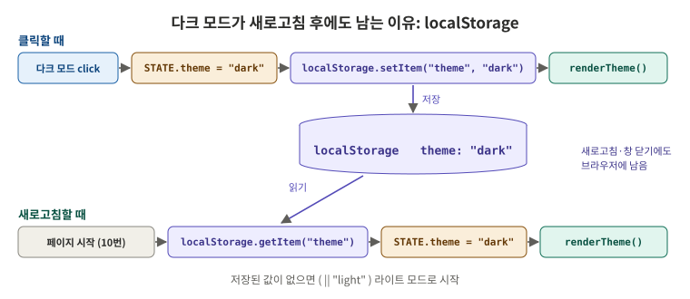

- `localStorage`는 브라우저에 **이름: 값**을 저장하는 곳입니다. 새로고침하거나 창을 닫아도 남습니다. (탭을 닫으면 지워지는 건 `sessionStorage`)
- 값은 **문자열**로만 저장됩니다. 그래서 `"dark"`, `"light"`처럼 글자로 저장합니다.
- 클릭할 때 `setItem`으로 저장하고, 페이지가 시작될 때 `getItem`으로 꺼내 STATE에 넣고 `renderTheme()`을 부릅니다.

**이 레포 코드**: [style.css 1번 변수](../css/style.css#L6-L52), [app.js 3번 다크 모드](../js/app.js#L50-L65), [app.js 10번 시작](../js/app.js#L254-L260)

<details>
<summary><b>스스로 확인</b>: 처음 방문한 사람은 <code>localStorage.getItem("theme")</code> 결과가 무엇이고, 화면은 어떻게 될까?</summary>

```js
STATE.theme = localStorage.getItem(THEME_KEY) || "light";
```

저장된 적이 없으므로 `getItem`은 `null`을 돌려줍니다. `null || "light"`는 `"light"`이므로 라이트 모드로 시작합니다. 다크 모드 버튼을 한 번 누르면 그때부터 `"dark"`가 저장됩니다.
</details>

**더 보기**: [사용자 지정 CSS 속성(변수) 사용하기 (MDN)](https://developer.mozilla.org/ko/docs/Web/CSS/Guides/Cascading_variables/Using_custom_properties) · [localStorage와 sessionStorage (javascript.info)](https://ko.javascript.info/localstorage)

---

## 4. Flexbox와 Grid: 한 줄이냐, 바둑판이냐

> **Flexbox는 한 방향(가로 또는 세로) 한 줄 정렬**, **Grid는 행과 열을 동시에** 맞추는 배치.

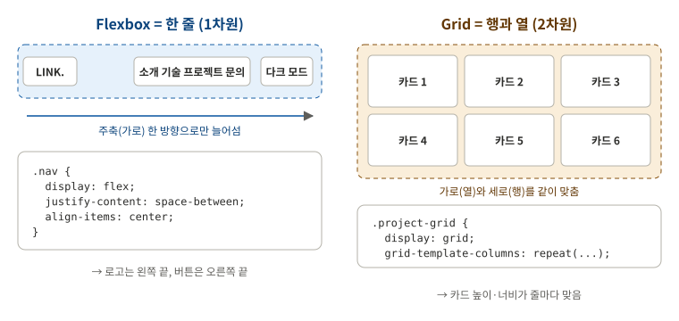

| | Flexbox | Grid |
|---|---|---|
| 차원 | 1차원 (한 줄) | 2차원 (행 × 열) |
| 잘하는 것 | 늘어선 것들의 간격, 정렬 (양 끝으로, 가운데로) | 줄마다 칸 크기가 맞는 격자 |
| 이 레포 | 네비게이션 `.nav`, 헤더 버튼, Hero 버튼, About, 푸터 | 기술 카드 `.skills`, 프로젝트 카드 `.project-grid` |

**네비게이션에 Flexbox를 고른 이유**: 로고, 메뉴, 버튼을 **가로 한 줄**에 놓고 양 끝으로 벌리기만 하면 됩니다. `justify-content: space-between`(주축 = 가로 방향 정렬), `align-items: center`(교차축 = 세로 방향 정렬) 두 줄이면 끝납니다.

**카드에 Grid를 고른 이유**: 카드가 두 줄 이상이 되면 **아랫줄 카드도 윗줄과 같은 너비**여야 깔끔합니다. Flexbox는 줄마다 따로 계산해서 마지막 줄 카드가 늘어나기 쉽고, Grid는 열이 정해져 있어 위아래가 맞습니다.

### repeat(auto-fit, minmax(280px, 1fr))

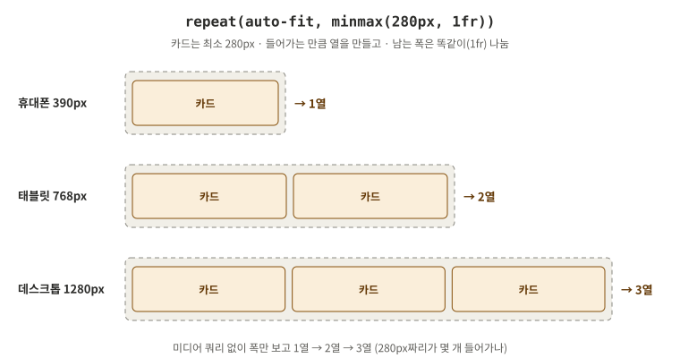

| 조각 | 뜻 |
|---|---|
| `minmax(280px, 1fr)` | 한 칸은 **최소 280px**, 남는 폭은 칸끼리 **똑같이** 나눔 (`fr` = 남은 공간의 비율) |
| `auto-fit` | 280px짜리 칸이 **들어가는 만큼** 열을 만듦 |
| `repeat(…)` | 위 규칙으로 열을 반복 |

그래서 프로젝트 카드는 **미디어 쿼리 없이** 폭에 따라 1열 → 2열 → 3열이 됩니다. 반대로 기술 카드(`.skills`)는 "모바일 1열, 태블릿 2열, 데스크톱 4열"로 **열 수를 직접 정하고 싶어서** 미디어 쿼리로 바꿨습니다. 두 방식을 비교해 볼 수 있게 일부러 다르게 했습니다.

**이 레포 코드**: [.nav](../css/style.css#L114-L121), [.skills](../css/style.css#L172-L179), [.project-grid](../css/style.css#L194-L203)

<details>
<summary><b>스스로 확인</b>: 화면 폭 768px에서 프로젝트 카드는 몇 열일까?</summary>

`.container` 폭 = 768 − 32(양옆 여백) = 736px, 카드 사이 간격(`gap`) 16px입니다.
- 3열에 필요한 폭: 280 × 3 + 16 × 2 = 872px → 736px에 안 들어감
- 2열에 필요한 폭: 280 × 2 + 16 = 576px → 들어감

그래서 **2열**이고, 남는 160px은 `1fr`로 두 칸이 나눠 가져 카드 하나가 360px이 됩니다.
</details>

**더 보기**: [flexbox의 기본 개념 (MDN, 주축/교차축 그림)](https://developer.mozilla.org/ko/docs/Web/CSS/Guides/Flexible_box_layout/Basic_concepts) · [그리드 레이아웃 기본 개념 (MDN)](https://developer.mozilla.org/ko/docs/Web/CSS/Guides/Grid_layout/Basic_concepts)

---

## 5. 모바일 퍼스트 반응형: 기본은 휴대폰, 넓어지면 더하기

> 미디어 쿼리 밖의 기본 스타일을 **가장 좁은 화면** 기준으로 쓰고, `@media (min-width: …)`로 **넓은 화면에 필요한 것만 더한다.**

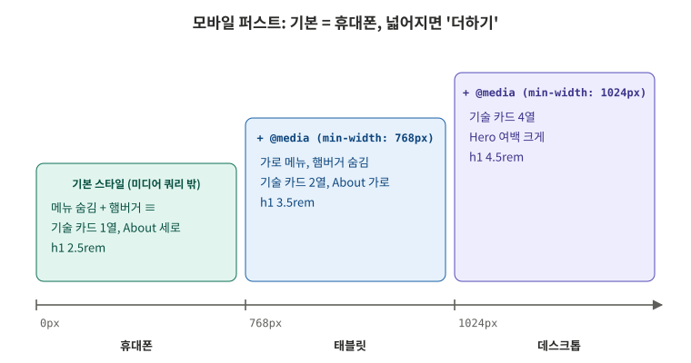

```css
.nav-menu { display: none; }        /* 기본(휴대폰): 메뉴 숨김 */
@media (min-width: 768px) {          /* 768px 이상일 때만 */
  .nav-menu { display: flex; }       /* 가로 메뉴로 */
  .menu-button { display: none; }    /* 햄버거 숨김 */
}
```

| | 모바일 퍼스트 (`min-width`) | 데스크톱 퍼스트 (`max-width`) |
|---|---|---|
| 기본 스타일 | 휴대폰 화면 | 데스크톱 화면 |
| 미디어 쿼리에서 하는 일 | 넓어질 때 **더하기** (열 늘리기, 메뉴 펼치기) | 좁아질 때 **되돌리기** (열 줄이기, 메뉴 숨기기) |
| 결과 | 단순한 1열에서 출발해 덮어쓸 규칙이 적음 | 복잡한 레이아웃을 하나하나 꺼야 해서 규칙이 늘어남 |

**왜 모바일 퍼스트인가**
- 좁은 화면은 대부분 1열이라 **가장 단순**합니다. 단순한 것에서 출발해 더하는 쪽이 코드가 적습니다.
- 요즘은 휴대폰으로 웹을 보는 사람이 많아서, **많이 쓰는 화면이 기본**이 됩니다.
- 좁은 화면부터 생각하면 **꼭 필요한 내용만** 먼저 고르게 됩니다.

**브레이크포인트**: 768px(태블릿), 1024px(데스크톱). `<meta name="viewport" content="width=device-width">`가 있어야 휴대폰이 실제 폭으로 그려서 미디어 쿼리가 맞게 동작합니다.

**이 레포 코드**: [style.css 5번 반응형](../css/style.css#L267-L294)

<details>
<summary><b>스스로 확인</b>: 폭 900px에서 <code>.skills</code>는 몇 열일까? (기본 1열, 768px 이상 2열, 1024px 이상 4열)</summary>

900px은 768px 이상이므로 `repeat(2, 1fr)`이 적용되고, 1024px 미만이므로 4열 규칙은 적용되지 않습니다. **2열**입니다. `min-width` 미디어 쿼리는 조건이 맞는 것이 **위에서부터 차례로 덮어씌워진다**고 생각하면 됩니다.
</details>

**더 보기**: [반응형 디자인 (MDN, 휴대폰/데스크톱 비교 그림)](https://developer.mozilla.org/ko/docs/Learn_web_development/Core/CSS_layout/Responsive_Design) · [미디어 쿼리 사용하기 (MDN)](https://developer.mozilla.org/ko/docs/Web/CSS/Guides/Media_queries/Using)

---

## 6. DOM 선택과 이벤트: 찾아서, 붙인다

> 브라우저는 HTML을 읽어 **DOM 트리**(객체 나무)를 만든다. JS는 `querySelector`로 나무에서 요소를 **찾고**, `addEventListener`로 "이 일이 생기면 이 함수"를 **붙인다.**

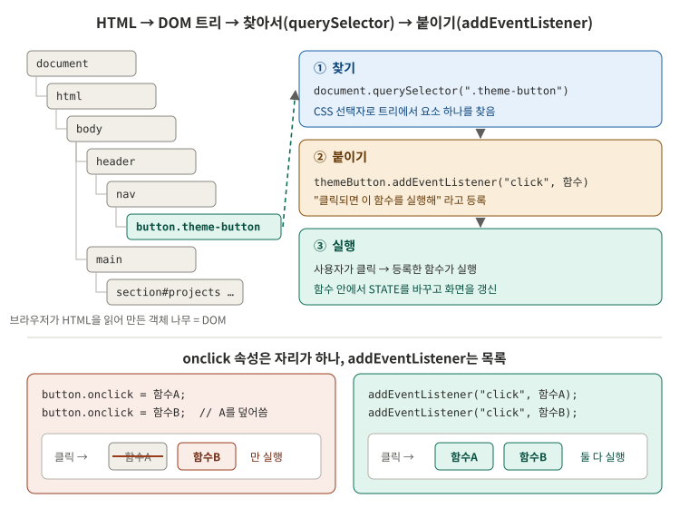

**DOM 조작에 쓴 것**

| 하는 일 | 메서드 | 이 레포 |
|---|---|---|
| 요소 하나 찾기 | `querySelector(".theme-button")` | app.js 2번 |
| 요소 여러 개 찾기 | `querySelectorAll(".reveal")` → `forEach`로 하나씩 | 5번 링크, 7번 애니메이션, 9번 입력칸 |
| 글자 바꾸기 | `textContent = "..."` | 버튼 글자, 상태 메시지, 오류 문구 |
| HTML 넣기 | `innerHTML = "<article>…"` | 프로젝트 카드 |
| 클래스 붙이기/떼기 | `classList.add` / `remove` / `toggle` | 9번 오류 테두리 / 7번 visible / 4번 메뉴 active |

`textContent`는 **글자 그대로**, `innerHTML`은 **HTML로 해석**합니다. 남이 쓴 글을 `innerHTML`로 넣으면 그 안에 숨긴 `` 같은 코드가 실행될 수 있어서, 남이 쓴 글은 `textContent`로 넣어야 안전합니다. (이 레포는 내 저장소 정보만 넣음)

**다룬 이벤트**

| 이벤트 | 언제 | 이 레포 |
|---|---|---|
| `click` | 클릭 | 다크 모드, 햄버거, 메뉴 링크, 맨 위로, 다시 시도 |
| `scroll` | 스크롤할 때마다 | 네비게이션 배경, 맨 위로 버튼 |
| `input` | 글자를 칠 때마다 | 폼 칸별 즉시 검사 |
| `submit` | 폼 제출 (버튼, Enter) | 폼 전체 검사 |

`event.preventDefault()`는 브라우저의 **기본 동작을 막습니다**. 링크 클릭의 순간 이동, 폼 제출의 페이지 새로고침을 막고 그 자리에 우리 코드(부드러운 스크롤, JS 검사)를 실행합니다.

### onclick 대신 addEventListener

| | `onclick` (HTML 속성, 또는 `요소.onclick = 함수`) | `addEventListener` |
|---|---|---|
| 쓰는 곳 | `<button onclick="toggle()">` 처럼 HTML 안 | JS 파일 안 |
| 같은 이벤트에 함수 여러 개 | **하나만**. 다시 대입하면 앞의 것을 덮어씀 | **여러 개** 등록, 모두 실행 |
| 역할 분리 | HTML에 동작 코드가 섞임 | HTML은 구조만, 동작은 JS에만 |

**이 레포 코드**: [app.js 2번 DOM 선택](../js/app.js#L33-L48), [3번 click](../js/app.js#L50-L65), [5번 preventDefault](../js/app.js#L82-L95), [9번 input/submit](../js/app.js#L230-L252)

<details>
<summary><b>스스로 확인</b>: 아래 코드를 실행하고 버튼을 누르면 콘솔에 무엇이 찍힐까?</summary>

```js
const button = document.querySelector(".theme-button");
button.onclick = () => console.log("A");
button.onclick = () => console.log("B");
button.addEventListener("click", () => console.log("C"));
button.addEventListener("click", () => console.log("D"));
```

`B`, `C`, `D`가 찍힙니다. `onclick`은 자리가 하나라 `A`가 `B`로 덮어쓰였고, `addEventListener`로 등록한 `C`, `D`는 둘 다 실행됩니다. (이 레포의 다크 모드 동작도 함께 실행됩니다)
</details>

**더 보기**: [DOM 트리 (javascript.info, 트리 그림)](https://ko.javascript.info/dom-nodes) · [브라우저 이벤트 소개 (javascript.info, onclick과 addEventListener 비교)](https://ko.javascript.info/introduction-browser-events)

---

## 7. 이벤트 → 상태 변경 → 화면 업데이트

> 이벤트 핸들러는 **STATE만** 바꾸고, 화면은 **render 함수만** 바꾼다. 그래서 "화면이 왜 이렇게 보이지?"의 답은 항상 STATE에 있다.

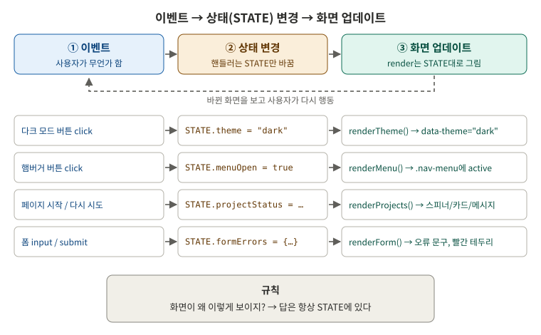

```js
const STATE = {
  theme: "light",            // 다크 모드
  menuOpen: false,           // 햄버거 메뉴
  projectStatus: "loading",  // GitHub 프로젝트 영역
  projects: [],
  formErrors: { name: "", email: "", message: "" }, // 폼 오류
  formSent: false,
};
```

**다크 모드로 따라가기** ([app.js 3번](../js/app.js#L50-L65))

| 단계 | 코드 | 일어나는 일 |
|---|---|---|
| ① 이벤트 | `themeButton.addEventListener("click", …)` | 사용자가 버튼 클릭 |
| ② 상태 변경 | `STATE.theme = "dark"` + `localStorage.setItem(…)` | 값만 바뀜, 화면은 아직 그대로 |
| ③ 화면 업데이트 | `renderTheme()` | `<html data-theme="dark">` → CSS 변수 → 전체 색 변경 |

**STATE 객체를 따로 만든 이유 (그냥 변수로 하면 안 되나?)**
- **한눈에 보임**: `let theme`, `let menuOpen`, `let status`…가 파일 곳곳에 흩어지면, 화면에 영향을 주는 값이 무엇인지 찾아야 합니다. STATE 객체의 목록이 곧 "**이 페이지의 상태 전부**"입니다.
- **화면이 어긋나지 않음**: 핸들러마다 DOM을 직접 고치면, 같은 화면을 여러 곳에서 고치다 서로 다르게 고치기 쉽습니다. render 함수 하나가 STATE를 보고 그리면 같은 STATE → 항상 같은 화면입니다.
- **확인이 쉬움**: 콘솔에서 `STATE.projectStatus = "empty"; renderProjects();`만 해도 빈 상태 화면이 나옵니다.
- **React로 이어짐**: React의 `useState`와 컴포넌트 렌더링이 바로 이 방식입니다. 상태를 바꾸면 React가 render를 대신 불러 줍니다.

변수로도 **동작은 똑같이** 만들 수 있습니다. 차이는 코드가 커질 때 **찾고, 고치고, 확인하기 쉬운가**입니다.

> 6번 스크롤(네비게이션 배경, 맨 위로 버튼)은 스크롤 위치만 보고 클래스 하나를 붙이는 한 줄이라 STATE를 거치지 않았습니다. 다른 기능에서 이 값을 쓰지 않기 때문입니다.

<details>
<summary><b>스스로 확인</b>: 폼의 이메일 칸에 <code>abc</code>를 입력했다. 이벤트 → 상태 → 화면 순서로 말해 보자.</summary>

1. **이벤트**: 글자를 칠 때마다 `input` 이벤트 → [app.js 9번](../js/app.js#L230-L237)의 핸들러 실행
2. **상태 변경**: `validate("email", "abc")`가 `"이메일 형식이 아닙니다. …"`를 돌려줌 → `STATE.formErrors.email`에 저장
3. **화면 업데이트**: `renderForm()`이 STATE.formErrors를 돌며 email 칸 아래 `.error-message`에 문구를 넣고 `.field`에 `error` 클래스 → CSS가 테두리를 빨갛게
</details>

**더 보기**: [State를 사용해 Input 다루기 (React 공식 문서, 상태별 화면 그림)](https://ko.react.dev/learn/reacting-to-input-with-state)

---

## 8. ES6+ 문법과 배열 메서드: GitHub 데이터 → 카드

> GitHub가 준 **객체 배열**을 `filter`로 거르고, `map`으로 **HTML 문자열 배열**로 바꾸고, `join`으로 합쳐 화면에 넣는다.

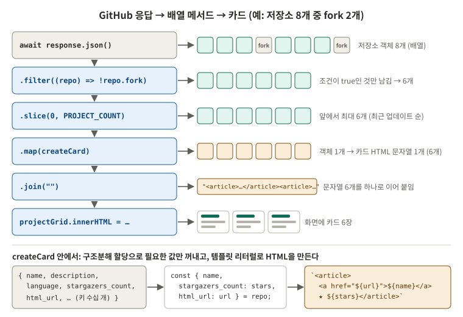

**배열 메서드**

| 메서드 | 하는 일 | 돌려주는 것 | 이 레포 |
|---|---|---|---|
| `map(함수)` | 원소마다 함수를 적용 | **같은 개수**의 새 배열 | 객체 → 카드 HTML |
| `filter(함수)` | 함수가 `true`인 원소만 남김 | **같거나 적은** 새 배열 | fork 제외 |
| `forEach(함수)` | 원소마다 함수 실행 | 없음 (`undefined`) | 링크, 입력칸, `.reveal`에 이벤트 연결 |
| `some(함수)` | 하나라도 `true`인가 | `true` / `false` | 폼에 오류가 하나라도 있나 |

for문으로 빈 배열에 `push`해도 되지만, `map`, `filter`는 **이름만 보고 무엇을 하는지** 알 수 있고 원래 배열을 바꾸지 않습니다.

**ES6+ 문법**

| 문법 | 예 (이 레포) | 왜 |
|---|---|---|
| 화살표 함수 | `(repo) => !repo.fork` | `function` 없이 짧게. 배열 메서드에 넘기는 작은 함수에 특히 편함 |
| 템플릿 리터럴 | `` `<h3>${name}</h3>` `` | 백틱(`)으로 여러 줄 문자열, `${}`로 값 끼워 넣기. `"<h3>" + name + "</h3>"`보다 읽기 쉬움 |
| 구조분해 할당 | `const { name, html_url: url } = repo;` | 객체에서 필요한 값만 꺼내 변수로. `:`은 **이름 바꾸기** (`html_url` → `url`) |
| 배열 구조분해 | `([name, message]) => …` | `["email", "형식 오류"]`에서 순서대로 꺼냄 |
| `const` / `let` | 다시 대입 안 하면 `const` | **다시 대입**을 막음. 객체 안의 값은 바꿀 수 있음 (`const STATE`의 `STATE.theme = "dark"`처럼). `var`는 블록 밖으로 새어 나가서 쓰지 않음 |

**이 레포 코드**: [createCard, renderProjects](../js/app.js#L141-L170), [loadProjects 안의 filter/slice](../js/app.js#L172-L199)

<details>
<summary><b>스스로 확인</b>: 아래 배열에 같은 filter, map을 하면 결과는?</summary>

```js
const repos = [
  { name: "a", fork: false },
  { name: "b", fork: true },
  { name: "c", fork: false },
];
const result = repos.filter((repo) => !repo.fork).map((repo) => `<h3>${repo.name}</h3>`);
```

`filter`로 b가 빠져 `[{name:"a"}, {name:"c"}]`, `map`으로 `["<h3>a</h3>", "<h3>c</h3>"]`가 됩니다. `result.join("")`은 `"<h3>a</h3><h3>c</h3>"`입니다.
</details>

**더 보기**: [배열과 메서드 (javascript.info)](https://ko.javascript.info/array-methods) · [구조 분해 할당 (javascript.info, 그림)](https://ko.javascript.info/destructuring-assignment)

---

## 9. 비동기: fetch, async/await, try/catch

> 서버 응답은 **언제 올지 모른다.** `await`로 기다린 뒤, 결과에 따라 **loading → success / empty / error** 중 하나로 상태를 바꾸고 그린다.

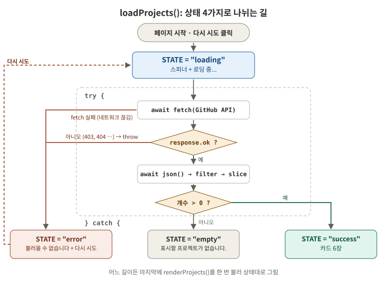

| 개념 | 뜻 |
|---|---|
| `fetch(url)` | 서버에 요청. 결과 대신 **Promise**(나중에 올 값을 담을 약속)를 바로 돌려줌 |
| `async` 함수 | 안에서 `await`를 쓸 수 있는 함수 |
| `await` | Promise의 결과가 올 때까지 **이 함수 안에서만** 기다림. 그동안 스크롤, 클릭 등 페이지의 다른 동작은 멈추지 않음 |
| `try { } catch { }` | `try` 안에서 에러가 나면 바로 `catch`로 건너뜀 |
| `response.ok` | 상태 코드가 200번대면 `true` |

**성공과 실패를 나누는 길** ([loadProjects](../js/app.js#L172-L199))

| 상황 | 어디로 | 상태 | 화면 |
|---|---|---|---|
| 요청 시작 | - | `loading` | 스피너 + "로딩 중..." |
| 응답 200, 저장소 있음 | `try` 끝까지 | `success` | 카드 |
| 응답 200, 저장소 0개 | `try` 끝까지 | `empty` | "표시할 프로젝트가 없습니다." |
| 응답 403, 404 등 | `throw` → `catch` | `error` | "불러올 수 없습니다." + 다시 시도 |
| 네트워크 끊김 | `fetch`가 에러 → `catch` | `error` | 위와 같음 |

**`response.ok`를 직접 확인하는 이유**: `fetch`는 서버가 **응답을 주기만 하면** 403(요청 횟수 초과)이든 404든 에러를 던지지 않습니다. 에러는 네트워크가 끊겨 응답 자체를 못 받았을 때만 납니다. 그래서 `ok`가 아니면 직접 `throw`해서 `catch`로 보냅니다.

**GitHub API 요청 제한**: 로그인 없이 부르면 **IP당 시간당 60번**까지입니다. 넘으면 403(또는 429) 응답이 오고, 위 표대로 에러 상태가 됩니다. 짧은 시간에 새로고침을 반복하지 않도록 합니다.

<details>
<summary><b>스스로 확인</b>: 아래 코드에서 <code>await</code>를 빼면 어떻게 될까?</summary>

```js
const response = fetch(url);          // await 없음
const repos = await response.json();
```

`fetch`가 응답 대신 **Promise**를 돌려주므로 `response`는 응답 객체가 아닙니다. Promise에는 `json` 메서드가 없어 `TypeError: response.json is not a function`이 나고, `catch`로 가서 에러 상태가 됩니다.

실제 `loadProjects`에서는 그보다 먼저 `if (!response.ok)`에 걸립니다. Promise에는 `ok`도 없어서(`undefined`) `!undefined`가 `true`가 되고, `"GitHub 응답 오류: undefined"`를 throw해 역시 에러 상태가 됩니다. 어느 쪽이든 **응답을 기다리지 않으면 데이터를 쓸 수 없습니다**.
</details>

**더 보기**: [async와 await (javascript.info)](https://ko.javascript.info/async-await) · [GitHub REST API 속도 제한 (GitHub Docs)](https://docs.github.com/ko/rest/using-the-rest-api/rate-limits-for-the-rest-api)

---

## 10. Intersection Observer: 보이면 나타나기

> "이 요소가 화면에 **20% 들어오면** 알려 줘" 하고 브라우저에 맡기는 감시자. 알림을 받으면 `visible` 클래스를 붙이고 CSS transition이 애니메이션을 한다.

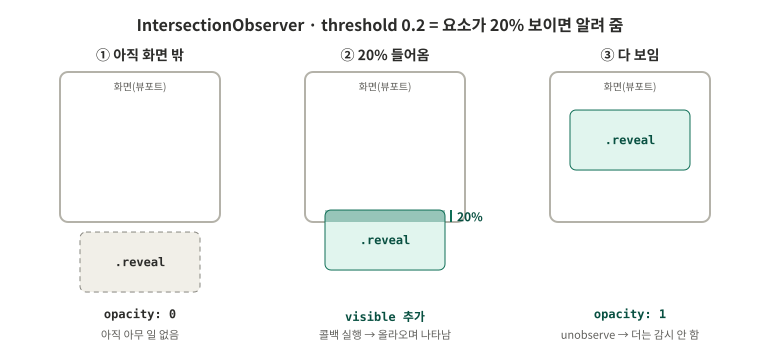

| 조각 | 뜻 |
|---|---|
| `new IntersectionObserver(콜백, { threshold: 0.2 })` | 감시자 만들기. 요소가 20% 보이는 순간을 넘나들 때 콜백 실행 |
| `observer.observe(요소)` | 이 요소를 감시 시작 |
| `entry.isIntersecting` | 지금 화면 안에 들어와 있는가 |
| `observer.unobserve(요소)` | 감시 끝. 한 번 나타나면 다시 숨기지 않으므로 |

**threshold를 0.2로 정한 이유**: 0이면 1px만 걸쳐도 시작해서, 애니메이션이 화면 맨 아래에서 일어나 잘 안 보입니다. 1이면 요소가 다 들어와야 시작해서, 큰 요소는 늦게 나타납니다. 0.2는 **조금 들어왔을 때** 시작해 자연스럽습니다.

**scroll 이벤트 대신 쓰는 이유**: scroll 이벤트로 하면 스크롤할 때마다 요소 위치를 직접 계산해야 하고, 1초에 수십 번 실행됩니다. Intersection Observer는 **보이는 정도가 바뀔 때만** 브라우저가 알려 줍니다.

**이 레포 코드**: [app.js 7번](../js/app.js#L110-L128), [style.css .reveal](../css/style.css#L262-L265)

<details>
<summary><b>스스로 확인</b>: <code>.reveal</code> 요소가 처음에 안 보이는 이유와, 나타날 때 움직이는 이유는?</summary>

```css
.reveal { opacity: 0; transform: translateY(30px); transition: opacity 0.6s, transform 0.6s; }
.reveal.visible { opacity: 1; transform: none; }
```

처음엔 `opacity: 0`(투명)이고 30px 아래에 있습니다. JS가 `visible`을 붙이면 `opacity: 1`, 원래 위치로 바뀌고, `transition` 때문에 0.6초 동안 **서서히** 바뀌어 올라오며 나타나는 것처럼 보입니다.
</details>

**더 보기**: [Intersection Observer API (MDN)](https://developer.mozilla.org/ko/docs/Web/API/Intersection_Observer_API)
